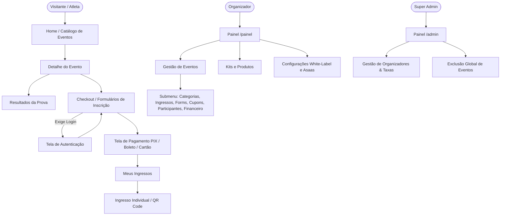

# RELATÓRIO DE AUDITORIA COMPLETA DE PRODUTO, ENGENHARIA, UX E QA
**Projeto:** Ruver (Plataforma de Gestão de Eventos, Inscrições e Resultados Esportivos)  
**Ambiente Auditado:** Local / Workspace `Site` (Conexão Produção)  
**Data da Auditoria:** 24 de Novembro de 2026  
**Auditor Responsável:** Auditor Sênior de Produtos Web (Engenharia, UX & QA)  
**Modo:** Somente Leitura (Nenhum código ou dado do sistema foi alterado)

---

## 1. RESUMO EXECUTIVO

| Métrica | Avaliação |
| :--- | :--- |
| **Nota Geral de Saúde do Produto** | **5.8 / 10** |
| **Segurança e Proteção de Dados** | **4.0 / 10** (Vulnerabilidades críticas encontradas) |
| **Estabilidade & Lógica de Negócio** | **6.0 / 10** (Divergências financeiras e de rotas) |
| **Experiência do Usuário (UX/UI)** | **6.5 / 10** (Quebra de links móveis e navegação) |
| **Engenharia & Arquitetura** | **6.8 / 10** (Estrutura Laravel sólida, mas com dead code e pontas soltas) |
| **SEO & Acessibilidade** | **4.5 / 10** (Ausência de metadados sociais, tags vazias e contrastes) |

### Diagnóstico Sintético
O sistema **Ruver** é uma plataforma Laravel rica em funcionalidades, possuindo um modelo de dados abrangente para gestão de ingressos, lotes, formulários dinâmicos por participante, kits/produtos e split de pagamento via Asaas, além de uma arquitetura White-Label multi-tenant por domínio próprio.

No entanto, a auditoria identificou **3 falhas de severidade CRÍTICA** que colocam em risco direto as receitas e a integridade da operação antes de uma escala em produção:
1. **Bypass de Pagamento / Emissão Gratuita de Ingressos:** A rota `POST /pedido/{order}/confirmar-pagamento` está aberta e permite que qualquer cliente autenticado marque seu próprio pedido como `pago` sem qualquer validação junto ao Asaas.
2. **Falha de Autorização no Check-in (IDOR):** Qualquer organizador autenticado na plataforma pode validar e dar baixa em ingressos de **outros** organizadores através da rota de portaria.
3. **QR Code Quebrado nos Ingressos Impressos:** O QR Code impresso no ingresso individual aponta para uma URL inexistente (`/{id}/{doc}` em vez de `/validar/{id}/{doc}`), resultando em erro 404 em todas as leituras na portaria física.

Adicionalmente, foram detectadas divergências no cálculo de taxa de plataforma entre o JavaScript do checkout e o backend PHP, quebra total na exibição de resultados no formato RaceTag (`results.json`), e o link simbólico de arquivos de storage apontando para um caminho absoluto da máquina local do desenvolvedor (`/Users/diogoconstante/Documents/Ruver/Ruver-2027/...`), o que causará erro 404 generalizado em todas as fotos e comprovantes quando hospedado em servidor remoto.

---

## 2. DOCUMENTAÇÃO DO SISTEMA (COMO O SITE FUNCIONA)

### 2.1 Stack Tecnológica e Arquitetura
- **Backend:** PHP 8.3+ com framework **Laravel 13.23.0**.
- **Frontend:** Laravel Blade, Tailwind CSS 3.1 com plugin `@tailwindcss/forms`, Vite 8.0, Alpine.js 3.x.
- **Banco de Dados:** MySQL (conexão remota configurada no `.env` em `painel.thrudelivery.com.br`).
- **Autenticação:** Laravel Breeze (sessões via banco de dados `sessions`).
- **Pagamentos & Split:** API REST do **Asaas v3** (PIX, Boleto e Cartão de Crédito com Split de Taxa de Plataforma).
- **Processamento de Resultados de Corridas:** Suporte a arquivos XML do sistema Weclex (`.clac`, `.clax`) e arquivos JSON do sistema RaceTag (`results.json`).
- **Agendamento em Segundo Plano:** Laravel Scheduler configurado para acionar o comando `tickets:release-expired` a cada minuto via Cron.

### 2.2 Estrutura de Pastas e Componentes
- `app/Http/Controllers/PublicController.php`: Catálogo inicial de eventos, página pública do evento e processamento/leitura de resultados esportivos.
- `app/Http/Controllers/CheckoutController.php`: Carrinho de compras, formulários dinâmicos de inscrição, processamento do pedido com Asaas, telas de pagamento e exibição do ingresso criptografado.
- `app/Http/Controllers/CheckinController.php`: Validação portaria/fiscal via QR Code ou documento.
- `app/Http/Controllers/WebhookAsaasController.php`: Receptor assíncrono de notificações de pagamento e cancelamento do gateway.
- `app/Http/Controllers/Organizer/`: Módulo de gestão do organizador (Eventos, Categorias, Lotes/Ingressos, Cupons, Participantes, Produtos/Kits, Formulários Dinâmicos, Configurações White-Label e Financeiro).
- `app/Http/Controllers/Admin/`: Módulo Super Admin (Painel consolidado com taxa de faturamento, gestão de organizadores e controle global de eventos).
- `app/Http/Middleware/IdentifyTenant.php`: Interceptor de domínio para White-Label (identifica o organizador pelo host HTTP).
- `app/Http/Middleware/CheckRole.php`: Autorização baseada em papéis (`admin`, `organizador`, `cliente`).
- `app/Services/AsaasPaymentService.php`: Integração de clientes, criação de cobranças e requisição de QR Codes PIX.

### 2.3 Mapeamento de Rotas e Fluxo de Navegação



### 2.4 Fluxos Principais Detalhados

#### Fluxo 1: Compra de Ingressos e Inscrição
1. **Seleção:** Na página `GET /evento/{slug}`, o usuário escolhe a quantidade em um ou mais lotes/ingressos e clica em "Comprar Ingressos".
2. **Carrinho (`GET /checkout`):**
   - O sistema carrega os formulários dinâmicos vinculados àquele lote (`campos-formularios-checkout.blade.php`).
   - Carrega variações de kits e produtos opcionais vinculados ao lote.
   - O usuário pode clicar no botão "Sou eu" para autocompletar os dados do Participante 1 com os dados da sua conta.
   - Valida idade mínima exigida pelo lote via JavaScript.
   - Aplica 50% de desconto automático para participantes com 60+ anos (Estatuto do Idoso) se o ingresso permitir.
3. **Criação do Pedido (`POST /checkout`):**
   - Valida documentos (CPF ou Passaporte), perguntas obrigatórias do formulário dinâmico e anexos de imagem (máx. 2MB).
   - Registra o pedido na tabela `orders` como `pendente`.
   - Dispara a cobrança na API do Asaas (PIX, Boleto ou Cartão de Crédito).
   - Salva cada atleta na tabela `order_participants` e registra respostas na tabela `form_answers`.
   - Baixa o estoque do ingresso e o estoque de produtos/atributos selecionados.
4. **Pagamento (`GET /pedido/{order}/pagamento`):**
   - Se for PIX: renderiza o QR Code dinâmico via `qrcodejs` e o código Copia e Cola, com contador de tempo e polling via AJAX (`GET /pedido/{order}/status`) a cada 5 segundos.
   - Se for Boleto: exibe link direto para o PDF bancário do Asaas.
   - Se for Cartão: exibe confirmação de processamento.
5. **Confirmação:**
   - O webhook do Asaas recebe o evento `PAYMENT_RECEIVED` em `POST /webhook/asaas`, valida o token de autenticação do organizador e altera o status do pedido para `pago`.

#### Fluxo 2: Portaria e Check-in no Evento
1. O atleta apresenta o QR Code impresso no ingresso ou no celular (`GET /ingresso/{participant}`).
2. A equipe da portaria lê o QR Code. A rota esperada é `GET /validar/{id}/{documento}`.
3. O `CheckinController` verifica:
   - Se quem está logado tem permissão (`admin` ou `organizador`).
   - Se o documento lido confere com o CPF/Passaporte do participante.
   - Se o pedido está com status `pago`.
   - Se o ingresso já foi utilizado (`checkin_at` preenchido).
4. Se válido, salva `checkin_at = now()` e exibe na tela "ENTRADA LIBERADA".

#### Fluxo 3: White-Label por Domínio do Organizador
1. O organizador cadastra seu domínio personalizado (ex.: `copasul.com.br`) em `painel/configuracoes`.
2. Quando um cliente acessa `copasul.com.br`, o middleware `IdentifyTenant` detecta o host, localiza o organizador correspondente e injeta as cores (`cor_marca`), logotipo (`logo`) e favicon (`icone`) dinamicamente no layout.
3. A listagem de eventos filtra automaticamente apenas os eventos pertencentes àquele organizador.

---

## 3. AUDITORIA DE FALHAS (POR GRAVIDADE)

### 🔴 FALHAS CRÍTICAS

#### [F-01] Rota de Confirmação Manual de Pagamento Aberta ao Comprador
- **Localização:** `app/Http/Controllers/CheckoutController.php` (linhas 767–779) e `routes/web.php` (linha 241).
- **Evidência no Código:**
  ```php
  // CheckoutController.php
  public function confirmPayment(Order $order)
  {
      if ($order->user_id !== auth()->id()) {
          abort(403, 'Acesso não autorizado ao pedido.');
      }
      $order->update(['status' => 'pago']);
      return redirect()->route('my.tickets')->with('success', 'Pagamento confirmado com sucesso!');
  }
  ```
- **Passos para Reproduzir:**
  1. Efetuar o checkout de qualquer ingresso de qualquer valor escolhendo PIX.
  2. Anotar o número do pedido gerado (ex.: Pedido #45).
  3. Fazer uma requisição `POST /pedido/45/confirmar-pagamento` com cabeçalho CSRF autenticado como o comprador.
  4. O pedido é instantaneamente marcado como `pago`, o QR Code do ingresso é gerado e o usuário obtém ingressos gratuitos sem pagar R$ 1,00.
- **Impacto:** Financeiro devastador. Fraude direta na emissão de inscrições.

---

#### [F-02] Falha de Autorização no Check-in da Portaria (IDOR)
- **Localização:** `app/Http/Controllers/CheckinController.php` (linhas 13–16).
- **Evidência no Código:**
  ```php
  $user = auth()->user();
  if (!in_array($user->role, ['admin', 'organizador'])) {
      abort(403, 'Acesso Negado: Apenas a equipe do evento pode validar ingressos.');
  }
  $participant = OrderParticipant::with('order.ticket.event')->find($id);
  ```
- **Descrição do Problema:** O controller valida apenas se o usuário logado possui a role `organizador`, mas **não valida** se o evento daquele ingresso pertence ao organizador logado (`$participant->order->ticket->event->organizer_id === $user->organizer->id`).
- **Passos para Reproduzir:**
  1. Fazer login como Organizador "Empresa A".
  2. Acessar a URL `/validar/{id}/{documento}` com ID de um ingresso de um evento da "Empresa B".
  3. O sistema dá baixa com sucesso no ingresso da Empresa B.
- **Impacto:** Quebra de integridade e invasão de escopo entre concorrentes/organizadores na mesma plataforma.

---

#### [F-03] URL do QR Code Quebrada no Ingresso Individual (Erro 404 na Portaria)
- **Localização:** `resources/views/ticket-show.blade.php` (linha 226).
- **Evidência no Código:**
  ```javascript
  new QRCode(document.getElementById("qrcode"), {
      text: "{{ url('/') }}/{{ $participant->id }}/{{ $participant->cpf ?: $participant->passaporte }}",
  ```
- **Descrição do Problema:** A rota configurada no roteador é `GET /validar/{id}/{documento}` (`routes/web.php` linha 245). No entanto, o script que gera a imagem do QR Code na impressão do ingresso omitiu a palavra `/validar/`, gerando links como `https://dominio.com/15/12345678900`.
- **Passos para Reproduzir:**
  1. Acessar qualquer ingresso pago em `/ingresso/{id}`.
  2. Escanear o QR Code gerado na tela com a câmera do celular.
  3. A URL aberta é `dominio.com/{id}/{cpf}`, que não existe e retorna página 404 (Not Found).
- **Impacto:** Parada total na operação de portaria no dia do evento. Nenhum ingresso impresso por esta tela poderá ser validado por leitura de QR Code.
DIOGO

---

### 🟠 FALHAS DE ALTA GRAVIDADE

#### [F-04] Divergência no Cálculo da Taxa da Plataforma (Frontend vs. Backend)
- **Localização:** `resources/views/checkout.blade.php` (linhas 547–554) vs `app/Http/Controllers/CheckoutController.php` (linhas 376–385).
- **Evidência no Código:**
  - *No Frontend JS:* Se `data-taxa-organizador === 'absorver'`, o JavaScript **não adiciona** a taxa da plataforma ao total da tela.
  - *No Backend PHP:*
    ```php
    $totalTaxa = ($subtotalIngressos + $totalProdutos) * ($organizer->taxa_plataforma / 100);
    $valorGeral = $subtotalIngressos + $totalProdutos + $totalTaxa;
    ```
    O backend **sempre soma** a taxa ao `$valorGeral` cobrado do comprador, ignorando a configuração de `taxa_organizador` do lote!
- **Impacto:** O cliente visualiza no carrinho um valor (ex.: R$ 100,00), mas a cobrança enviada para o Asaas é gerada com valor superior (ex.: R$ 110,00). Isso causa abandono de checkout, desconfiança e risco de processos no Procon por propaganda enganosa.

---

#### [F-05] Aplicação de Cupons Vencidos ou Esgotados no Checkout Backend
- **Localização:** `app/Http/Controllers/CheckoutController.php` (linhas 392–420).
- **Descrição do Problema:** Na validação assíncrona (`validarCupom`, linhas 666–678), o sistema confere `data_inicio`, `data_termino` e `quantidade_total >= quantidade_usada`. Porém, no momento final da gravação do pedido (`store`), o código apenas consulta:
  ```php
  $cupom = Coupon::where('codigo', $cupomCodigo)->where('event_id', ...)->where('ativo', true)->first();
  ```
  Ele não checa as datas de validade nem o saldo de uso no backend!
- **Impacto:** Qualquer usuário que submeter o código de um cupom expirado ou esgotado diretamente no formulário receberá o desconto indevidamente.

---

#### [F-06] Tela de Resultados Inoperante para Arquivos RaceTag (`results.json`)
- **Localização:** `resources/views/event-resultados.blade.php` (linhas 105 e 298) e `app/Http/Controllers/PublicController.php` (linha 236).
- **Descrição do Problema:** Quando o arquivo do evento é o `results.json` (sistema RaceTag), o controller normaliza a lista `$atletas`, define `$tipoImportacao = 'racetag'`, e mantém `$conteudoWeclex = null`. Contudo, na view `event-resultados.blade.php`, todo o bloco de tabelas e classificação está condicionado a `@if($conteudoWeclex)`. Como a variável é nula, a tela cai no bloco `@else` e exibe: *"Arquivo não encontrado ou inválido"*.
- **Impacto:** Perda de funcionalidade. Nenhuma corrida cronometrada com RaceTag exibe resultados aos atletas.

---

#### [F-07] Symlink do Storage Apontando para Diretório Local Absoluto
- **Localização:** `public/storage`.
- **Evidência no Terminal:**
  `public/storage -> /Users/diogoconstante/Documents/Ruver/Ruver-2027/storage/app/public`
- **Descrição do Problema:** O link simbólico gerado no projeto aponta para um diretório fixo da máquina do desenvolvedor em outra pasta (`Ruver-2027`).
- **Impacto:** Ao subir o site para qualquer hospedagem de produção (Hostinger, cPanel, VPS), todos os banners de eventos, fotos de organizadores, flyers e anexos de documentos retornarão erro 404.

---

#### [F-08] Quebra da Integração Asaas caso seja executado `php artisan config:cache`
- **Localização:** `app/Services/AsaasPaymentService.php` (linhas 17–25) e `config/services.php`.
- **Descrição do Problema:** O serviço faz chamadas diretas a `env('ASAAS_MASTER_API_KEY')` e `env('ASAAS_MASTER_WALLET_ID')`. No Laravel, quando o comando de otimização de cache `config:cache` é executado em produção, a função `env()` passa a retornar `null` fora dos arquivos da pasta `config/`.
- **Impacto:** A integração com o gateway de pagamentos para de funcionar completamente em ambiente de produção otimizado.

---

#### [F-09] Risco de Stored XSS na Descrição do Evento
- **Localização:** `resources/views/event-show.blade.php` (linha 253).
- **Evidência no Código:**
  ```blade
  {!! $event->descricao !!}
  ```
- **Descrição do Problema:** O campo `descricao` editado via TinyMCE é salvo no banco e renderizado com escape desativado `{!! !!}` sem passar por sanitização HTML (como `mews/purifier` ou `strip_tags` controlado). Se uma conta de organizador for comprometida ou um usuário mal-intencionado injetar tags `<script>`, cookies de sessão e dados de atletas podem ser roubados.

---

### 🟡 FALHAS DE MÉDIA GRAVIDADE

#### [F-10] Link "Meu Painel" no Topo Redireciona Clientes para Área Restrita do Organizador
- **Localização:** Navbars de `welcome.blade.php` (linha 63), `event-show.blade.php` (linha 74), `my-tickets.blade.php` (linha 72), `resultados-index.blade.php` (linha 71) e `event-resultados.blade.php` (linha 77).
- **Evidência no Código:**
  ```html
  <a href="{{ url('/painel') }}">Meu Painel</a>
  ```
- **Descrição do Problema:** `/painel` exige o papel `organizador`. Quando um cliente/atleta comum logado clica em "Meu Painel", ele é barrado pelo middleware `CheckRole` e redirecionado com mensagem de erro *"Acesso não autorizado"*.
- **Correção:** Alterar o link para `route('dashboard')`, que já possui o roteador inteligente por papel.

---

#### [F-11] Inconsistência de Vinculação do Organizador nos Controllers
- **Localização:** `FormController.php` (linha 21), `TicketCategoryController.php` (linha 15), `FinancialGlobalController.php` (linha 25), `TicketController.php` (linha 16).
- **Descrição do Problema:** Há 4 formas conflitantes utilizadas para descobrir qual é o organizador autenticado:
  - Busca por `user_id == auth()->id()`.
  - Busca por `email == auth()->user()->email`.
  - Busca pela relação `$user->organizer`.
  - Busca pelo campo `users.organizer_id`.
  Se o organizador atualizar seu e-mail no perfil (`/profile`), ou se o cadastro foi realizado sem preencher ambos os IDs cruzados, telas como formulários (`FormController`) lançam `ModelNotFoundException` (404), enquanto a tela de categorias busca por um organizador diferente.

---

#### [F-12] Duplicidade de Carregamento do Alpine.js
- **Localização:** `resources/js/app.js` (linhas 3–7) e `<script defer src="https://cdn.jsdelivr.net/npm/alpinejs@3.x.x/..."></script>` nas views `welcome.blade.php`, `my-tickets.blade.php`, `resultados-index.blade.php`, `event-resultados.blade.php`, `profile/edit.blade.php`.
- **Descrição do Problema:** O framework Alpine.js é inicializado pelo Vite e importado novamente via CDN em quase todas as views públicas.
- **Impacto:** Conflitos de event listeners no DOM, mensagens de erro no console e perda desnecessária de performance no carregamento de páginas.

---

#### [F-13] Comparação Estrita de CPF/Documento no Check-in
- **Localização:** `app/Http/Controllers/CheckinController.php` (linhas 26–28).
- **Evidência no Código:**
  ```php
  $docBanco = $participant->cpf ?: $participant->passaporte;
  if ($docBanco !== $documento) {
      return response("❌ Documento Inválido! Possível Fraude.", 403);
  }
  ```
- **Descrição do Problema:** O banco pode conter CPF formatado (`000.000.000-00`) ou apenas números (`00000000000`). Como o operador `!==` exige correspondência exata de caracteres, qualquer divergência de máscara bloqueia a entrada do atleta na portaria acusando fraude.

---

#### [F-14] Divergência entre Cronômetro PIX na Tela (5 min) e Rotina do Banco (15 min)
- **Localização:** `resources/views/order-payment.blade.php` (linha 190) e `app/Console/Commands/ReleaseExpiredTickets.php` (linha 27).
- **Descrição do Problema:** O JavaScript da tela de pagamento mostra um cronômetro de **5 minutos** e redireciona o cliente para a home dizendo que o pedido expirou. No entanto, o comando backend só expira o pedido e devolve os ingressos ao estoque após **15 minutos**.
- **Impacto:** O cliente é expulso da tela, mas os ingressos continuam bloqueados por mais 10 minutos, impedindo novas compras imediatas.

---

#### [F-15] Processamento de Dados de Cartão de Crédito sem Tokenização no Front (Escopo PCI)
- **Localização:** `resources/views/checkout.blade.php` (linhas 365–392) e `app/Http/Controllers/CheckoutController.php` (linhas 111–142).
- **Descrição do Problema:** Número do cartão, mês, ano e código de segurança (CVV) são postados em texto claro para o servidor da aplicação antes de serem enviados à API do Asaas.
- **Impacto:** Não conformidade com o padrão PCI-DSS. O tráfego e armazenamento temporário de dados brutos de cartão em servidores próprios expõe a empresa a responsabilidades legais severas em caso de vazamento.

---

### 🟢 FALHAS DE BAIXA GRAVIDADE / QUALIDADE DE CÓDIGO

#### [F-16] Código Morto no Projeto
- `app/Http/Controllers/PublicController_OLD.php`: Arquivo duplicado mantendo a mesma assinatura de classe `PublicController`.
- `resources/views/event-resultados.blade_OLD.php`: View antiga não utilizada.
- `database/migrations/2026_09_10_160222_add_checkin_at_to_order_participants_table.php`: Migration vazia.
- `database/migrations/2026_09_10_160231_add_checkin_at_to_order_participants_table.php`: Migration vazia.
- Trecho comentado de risco no final de `routes/web.php` contendo rota de instalação com comando `migrate:fresh --seed` e token hardcoded `'minha-senha-secreta-123'`.

#### [F-17] Favicon Vazio e Metadados Incompletos
- `public/favicon.ico` possui tamanho de 0 bytes (arquivo corrompido/em branco).
- Diversas páginas possuem títulos com placeholder genérico (`<title>{{ config('app.name', 'Laravel') }}</title>` ou `'IngressosApp'`).
- Inexistência de meta tags Open Graph (`og:image`, `og:title`, `og:description`) em `event-show.blade.php`, impedindo previews em links compartilhados no WhatsApp e redes sociais.

#### [F-18] Inexistência de Suíte de Testes Automatizados
- A pasta `tests/` não existe no repositório, embora existam dependências do PHPUnit no `composer.json`. Cobertura de testes: 0%.

---

## 4. LISTA DE ELEMENTOS E AÇÕES SEM FUNÇÃO ("NÃO LEVAM A NADA")

| Elemento / Componente | Onde Ocorre | Comportamento Observado | Comportamento Esperado |
| :--- | :--- | :--- | :--- |
| **Ícone 3: Troféu (Ranking)** | `resources/views/dashboard.blade.php` (L123) | Possui `href="#"`. Ao tocar no celular, apenas rola para o topo da página sem executar nada. | Apontar para `route('resultados.index')` (igual ao que já ocorre na Home). |
| **Ícone 3: Troféu (Ranking)** | `resources/views/event-resultados.blade.php` (L378) | Possui `href="#"`. Ao clicar, não leva a nenhuma página. | Apontar para `route('resultados.index')`. |
| **Link "← Início"** | `resources/views/profile/edit.blade.php` (L22) | Aponta para `route('cliente.dashboard')`. Se um Organizador ou Admin clicar, toma erro "Acesso não autorizado". | Apontar para `route('dashboard')` para direcionar conforme a role do usuário. |
| **Link "Meu Painel"** | Navbars públicas (`welcome`, `event-show`, `my-tickets`, `resultados-index`) | Aponta fixo para `url('/painel')`. Para clientes comuns (não organizadores), resulta em bloqueio 403 / redirecionamento com erro. | Apontar para `route('dashboard')`. |
| **Campo de Cupom no Checkout** | `resources/views/checkout.blade.php` (L396) | Existe um `<input type="hidden" name="valor_total_pedido" value="0">` que não é lido no backend. | Limpar campos ocultos órfãos que não possuem finalidade no processamento. |

---

## 5. TABELA DE MELHORIAS SUGERIDAS (IMPACTO x ESFORÇO x PRIORIDADE)

| ID | Melhoria Recomendada | Onde Ocorre | Impacto | Esforço | Prioridade | Riscos ao Implementar |
| :--- | :--- | :--- | :---: | :---: | :---: | :--- |
| **M-01** | **Remover rota de confirmação manual de pagamento** | `routes/web.php` e `CheckoutController.php` | **Alto** | **Baixo** | **Crítica** | Nenhum. O pagamento deve ser confirmado exclusivamente via Webhook do Asaas. |
| **M-02** | **Blindar autorização de portaria por organizador (Tenant check)** | `CheckinController.php` | **Alto** | **Baixo** | **Crítica** | Se houver organizadores sem vínculo formal configurado, eles não validarão ingressos até o vínculo estar correto. |
| **M-03** | **Corrigir prefixo `/validar/` no QR Code do ingresso** | `resources/views/ticket-show.blade.php` | **Alto** | **Baixo** | **Crítica** | Nenhum. Fará os QR Codes impressos funcionarem imediatamente. |
| **M-04** | **Sincronizar cálculo de taxa de plataforma (absorver vs repassar)** | `CheckoutController.php` (`store`) | **Alto** | **Médio** | **Alta** | Ajustar o split de pagamento do Asaas para descontar a taxa da wallet do organizador quando a taxa for absorvida. |
| **M-05** | **Validar datas e limite de cupons no backend (`store`)** | `CheckoutController.php` (`store`) | **Alto** | **Baixo** | **Alta** | Usuários com cupons vencidos não conseguirão mais concluir compra com desconto. |
| **M-06** | **Corrigir condicional de exibição de resultados RaceTag** | `resources/views/event-resultados.blade.php` | **Alto** | **Baixo** | **Alta** | Nenhum. Permitirá que os resultados em JSON voltem a ser exibidos. |
| **M-07** | **Configurar credenciais Asaas em `config/services.php`** | `config/services.php` e `AsaasPaymentService.php` | **Alto** | **Baixo** | **Alta** | Nenhum. Garante compatibilidade com `php artisan config:cache`. |
| **M-08** | **Recriar link simbólico do storage de forma relativa** | `public/storage` | **Alto** | **Baixo** | **Alta** | Nenhum. Necessário rodar `php artisan storage:link` no servidor de destino. |
| **M-09** | **Sanitizar HTML da descrição do evento (anti-XSS)** | `EventController.php` ou `event-show.blade.php` | **Alto** | **Médio** | **Alta** | Formatações complexas e scripts inline no editor serão filtrados. |
| **M-10** | **Corrigir redirecionamento de "Meu Painel" e "← Início"** | Navbars e `profile/edit.blade.php` | **Médio** | **Baixo** | **Importante** | Nenhum. Elimina telas de erro de acesso para atletas. |
| **M-11** | **Sanitizar dígitos de CPF no check-in** | `CheckinController.php` | **Médio** | **Baixo** | **Importante** | Nenhum. Aumenta a tolerância para documentos com e sem máscara. |
| **M-12** | **Alinhar tempo do cronômetro PIX com o cancelador backend** | `order-payment.blade.php` | **Médio** | **Baixo** | **Importante** | Nenhum. Alinha a expectativa visual do comprador com a rotina do robô. |
| **M-13** | **Remover importação duplicada do Alpine.js via CDN** | Views blade com tags `<script src="cdn...alpinejs">` | **Médio** | **Baixo** | **Importante** | Garantir que todos os componentes Alpine continuem funcionando pelo Vite. |
| **M-14** | **Unificar estratégia de recuperação do Organizador autenticado** | Controllers de `Organizer` | **Médio** | **Médio** | **Importante** | Requer garantir que `organizers.user_id` esteja preenchido em todos os organizadores da base. |
| **M-15** | **Adicionar meta tags OpenGraph e Favicon real** | `event-show.blade.php` e `public/favicon.ico` | **Médio** | **Baixo** | **Opcional** | Nenhum. Melhora compartilhamento em redes sociais. |
| **M-16** | **Limpar arquivos antigos e migrations vazias (Dead code)** | `PublicController_OLD.php`, migrations vazias | **Baixo** | **Baixo** | **Opcional** | Nenhum. Melhora legibilidade e organização do código. |

---

## 6. SUGESTÃO DE ORDEM DE EXECUÇÃO (ROADMAP RECOMENDADO)

### Fase 1: Segurança Crítica & Estancamento de Riscos (Prioridade Imediata)
1. **Desativar a rota `order.confirm_payment`:** Remover a rota e o método de confirmação manual em `routes/web.php` e `CheckoutController.php` para impedir compras gratuitas fraudulentas.
2. **Corrigir a URL do QR Code em `ticket-show.blade.php`:** Adicionar `/validar/` antes do ID para garantir que os ingressos emitidos possam ser lidos na portaria.
3. **Adicionar trava de Tenant no `CheckinController`:** Garantir que o organizador só possa validar ingressos dos seus próprios eventos.
4. **Validar vigência e quantidade de cupons no backend (`store`):** Impedir descontos indevidos com cupons esgotados ou fora do prazo.

### Fase 2: Integridade Financeira & Correção de Bugs de Negócio
5. **Ajustar cálculo de taxa (absorver vs. repassar):** Sincronizar o backend `store` com a regra visual do checkout para não cobrar a taxa do comprador quando o organizador optou por absorvê-la.
6. **Mapear Asaas em `config/services.php`:** Mover as chamadas `env()` de pagamento para o arquivo de configuração e evitar quebras de cache.
7. **Corrigir a visualização de resultados RaceTag em `event-resultados.blade.php`:** Ajustar o `@if` para renderizar os atletas normalizados do `results.json`.
8. **Sanitizar CPF no Check-in:** Aplicar limpeza de pontuação `preg_replace('/\D/', '', ...)` para aceitar documentos com ou sem máscara.

### Fase 3: UX, Navegação e Limpeza de Infraestrutura
9. **Corrigir links de navegação:** Substituir chamadas fixas a `/painel` nas navbars por `route('dashboard')`, permitindo que clientes acessem sua área sem erro 403.
10. **Ajustar link simbólico do storage (`storage:link`):** Limpar o link absoluto que aponta para o computador local e gerar link relativo válido para o ambiente de servidor.
11. **Remover CDN duplicada do Alpine.js:** Centralizar a execução pelo bundle Vite.
12. **Sanitizar HTML do TinyMCE:** Proteger a descrição de eventos contra Stored XSS.
13. **Excluir arquivos mortos (`_OLD.php` e migrations vazias).**

---
*Relatório concluído e emitido em conformidade com as diretrizes de modo somente leitura.*
